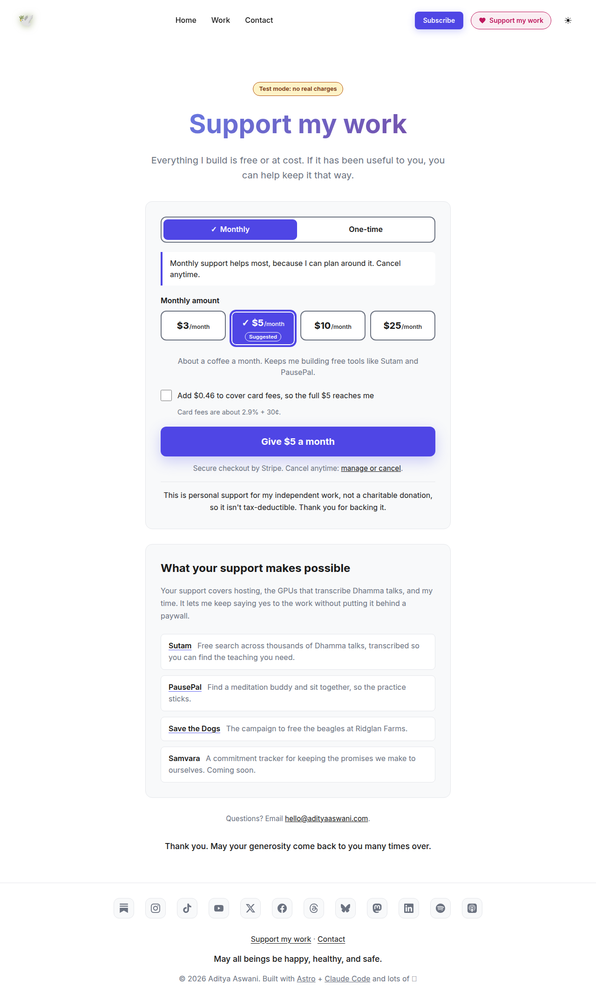
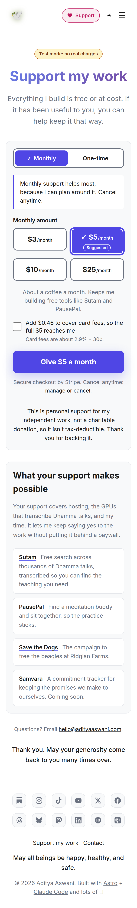
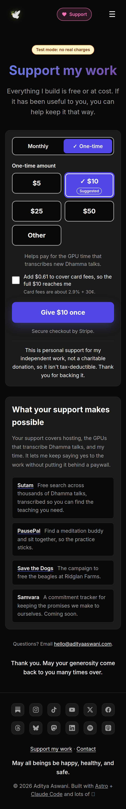
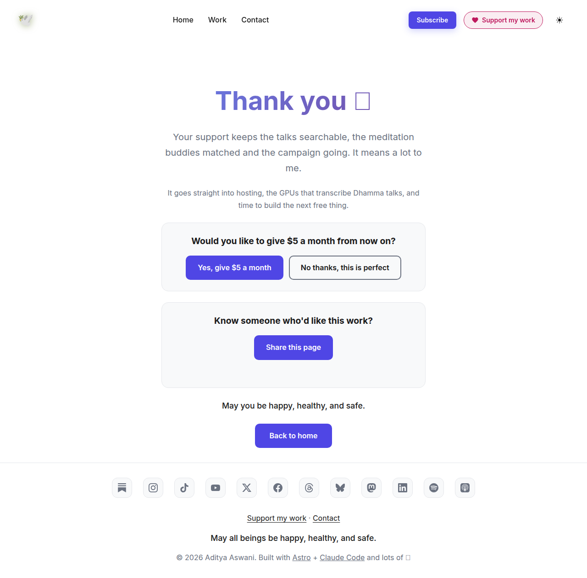
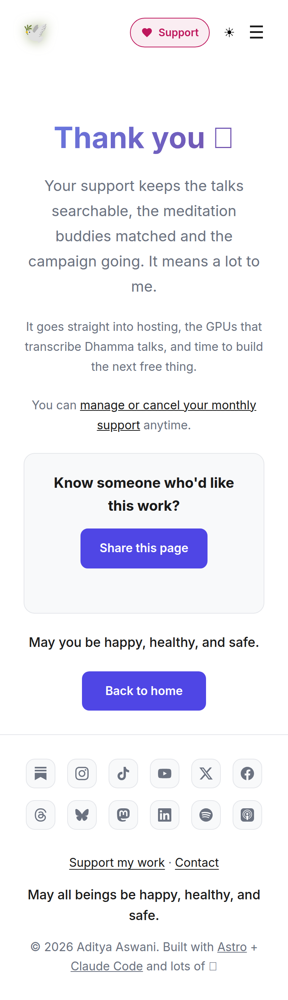
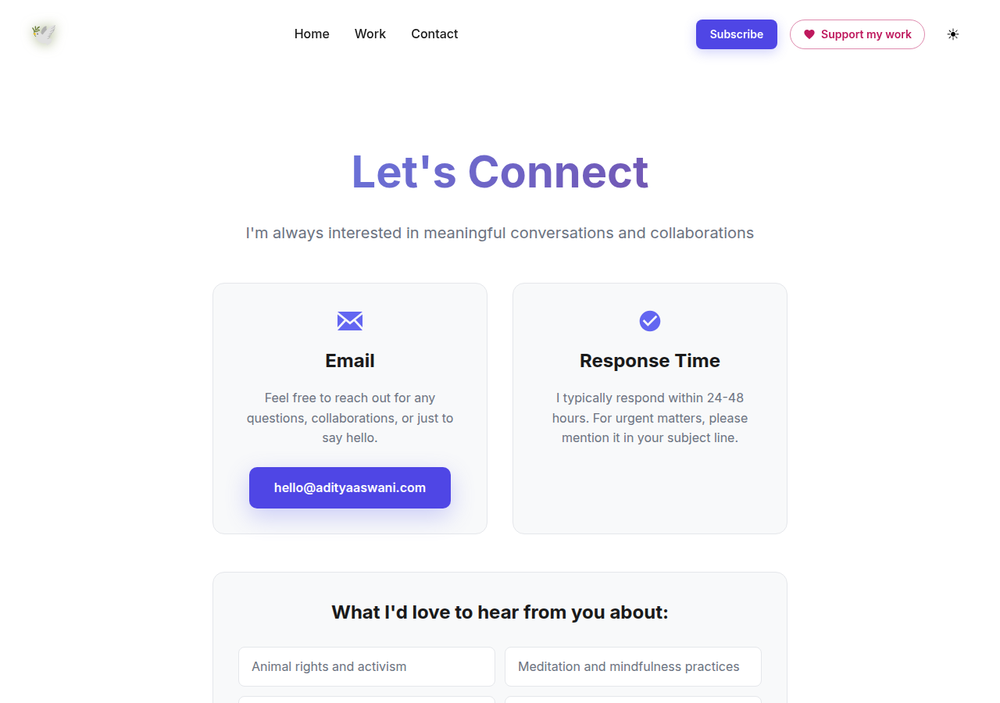
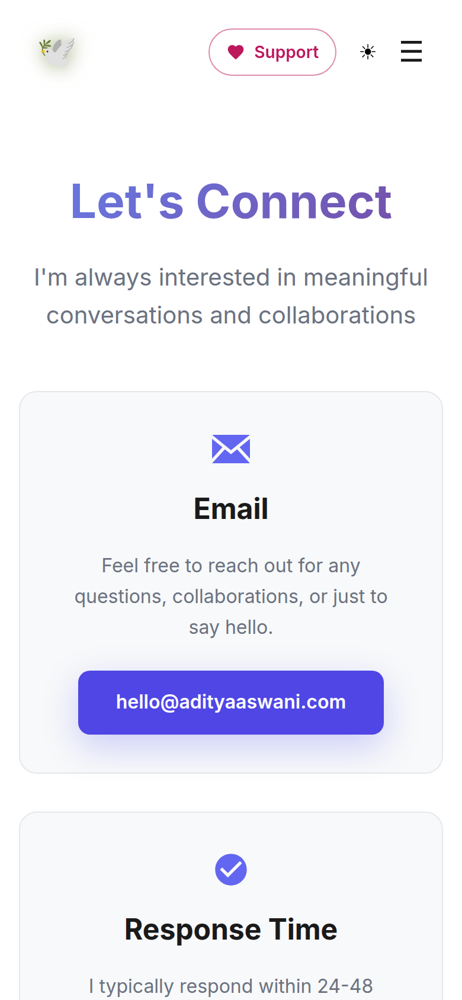
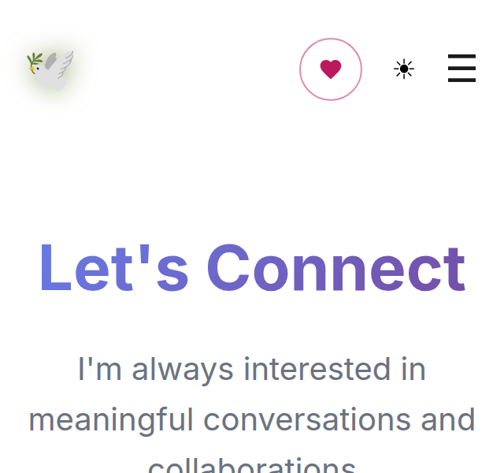
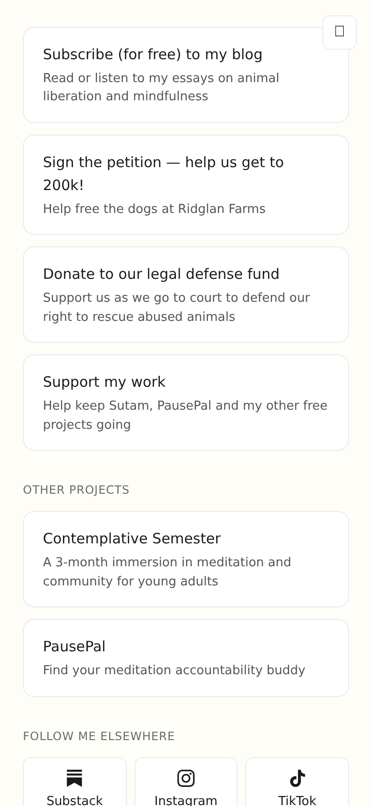

# 2026-10-11 (v2): /support redesign, header Support button, /links card

Branch `support-page` (PR #1), not live. There is no staging and the site only deploys from `main`, so this ran on a local static build (`astro build` → `serve`) with headless Chrome: Lighthouse 12.8 and axe-core 4.14 through puppeteer-core (tags wcag2a/2aa/21a/21aa/22aa/best-practice). Run PSI and Steel on the public URLs after merge.

## axe: 0 violations on every page, in both themes and both viewports

Pages: /, /contact, /links, /learn-meditation, /404, /support (Monthly and One-time states), /support/thanks (no type, `?type=once`, `?type=monthly`). Each was checked in light and dark themes at phone (390×844) and desktop (1280×900) sizes: 40 runs, all with 0 violations.

**Fixed in this pass.** The new header button touches every page, so the whole site was audited. That turned up pre-existing serious findings, and they were fixed in `2796d66`:
- `color-contrast`: white text on #6366f1 (4.47:1) on the buttons on home, contact, learn-meditation and 404. Changed to #4f46e5, with hover #4338ca. This is the same fix the nav Subscribe pill got earlier.
- `color-contrast`: the contact page's anonymous feedback button (white on #22c55e). Changed to #15803d.
- `color-contrast`: the light-theme section labels on /links (#888). Changed to #6b6b6b.
- `link-in-text-block`: the prose links on learn-meditation are now underlined.

## Lighthouse (mobile / desktop)

| Page | Perf | A11y | Best pr. | SEO |
|---|---|---|---|---|
| /support | 100 / 100 | 100 / 100 | 100 / 100 | 100 / 100 |
| / (mobile) | 67 | 100 | 79 | 100 |
| /links (mobile) | 95 | 100 | 79 | 100 |

**Deferred: home and /links.** Both pages load `public/aditya-photo-new.jpg`, a 6000×4050 JPEG of 13.2 MB. That accounts for about 13 MB of the image-size findings and the slow mobile LCP on home. The resize was blocked by the box's permission classifier in this session, so it needs the owner. One sharp command fixes it, for example resizing to 1000 px wide with mozjpeg q82. Best practices scores 79 because of third-party cookies (Substack embed) and an inspector issue. Neither of those comes from this branch.

## Give button behaviour (puppeteer, real clicks)

| State | Button | Link |
|---|---|---|
| default | Give $5 a month | monthly_5 |
| $5 + fees | Give $5.46 a month | monthly_5_fees |
| $25 + fees | Give $26.06 a month | monthly_25_fees |
| One-time default | Give $10 once | one-time `?prefilled_amount=1000` |
| $10 + fees | Give $10.61 once | `?prefilled_amount=1061` |
| Other, $7 + fees | Give $7.52 once | `?prefilled_amount=752` |
| Other, empty or 0 | Enter an amount (disabled) | none |

## Screenshots

Emoji show as boxes in these screenshots only because the audit box has no emoji font.
