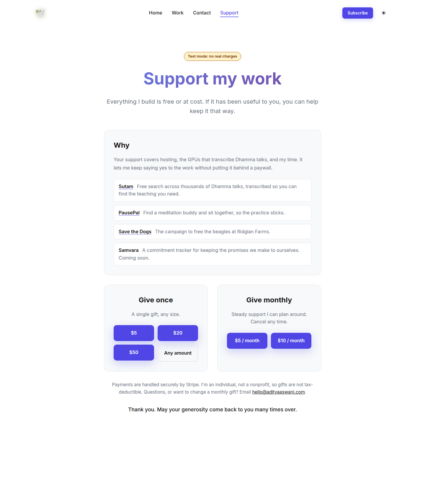
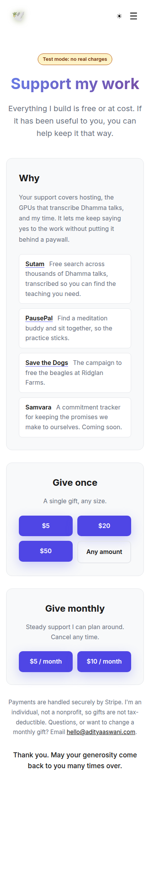
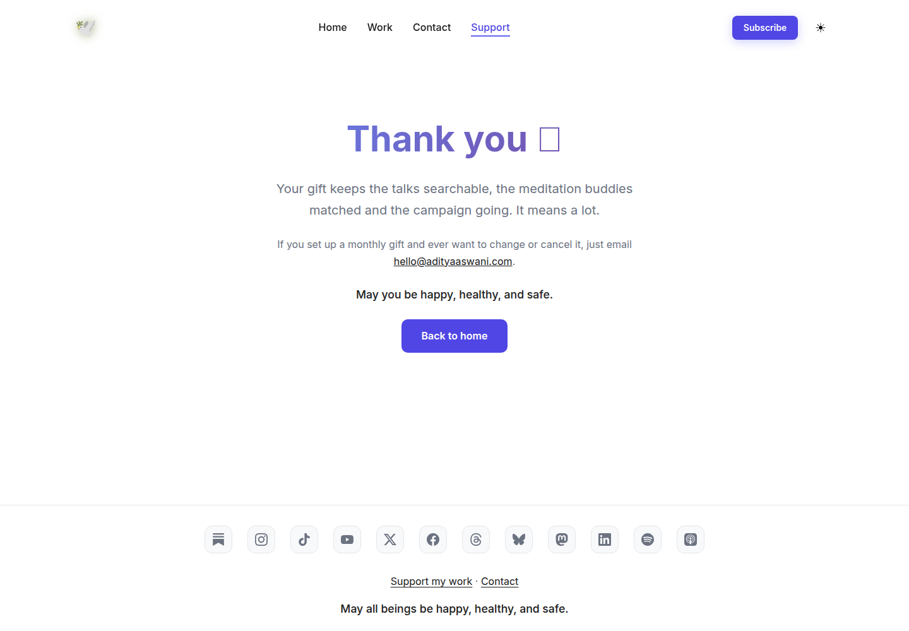

# 2026-10-11: /support and /support/thanks

Branch `support-page`, not live yet (the site only deploys from `main` and there is no staging), so the audit ran on a local static build (`astro build` → `serve`) with headless Chrome: Lighthouse CLI 12 and @axe-core/cli 4.10 (tags wcag2a/2aa/21a/21aa/22aa/best-practice). PSI on the public URL should be re-run after merge.

## Lighthouse, /support

| | Performance | Accessibility | Best practices | SEO |
|---|---|---|---|---|
| Mobile | 100 | 100 | 100 | 100 |
| Desktop | 100 | 100 | 100 | 100 |

Remaining flags are below the action threshold: cache TTL (an artifact of the local server; GitHub Pages sets its own headers) and an 8 KiB / 0 ms render-blocking note.

## axe

| Page | Light | Dark |
|---|---|---|
| /support | 0 violations | 0 violations |
| /support/thanks | 0 violations | 0 violations |

**Fixed:** `color-contrast` (serious) on the nav "Subscribe" pill, site-wide: white on #6366f1 was 4.47:1. It is now #4f46e5 (6.3:1), with hover #4338ca. The new support buttons use the same colours.

## Screenshots

Emoji glyphs show as boxes in these screenshots only because the audit box has no emoji font.
